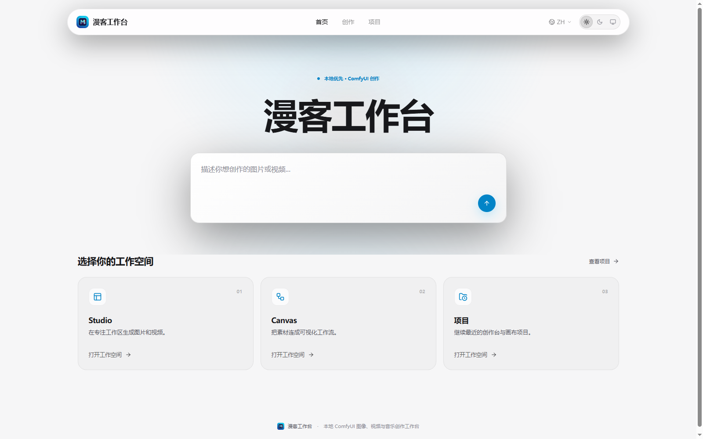
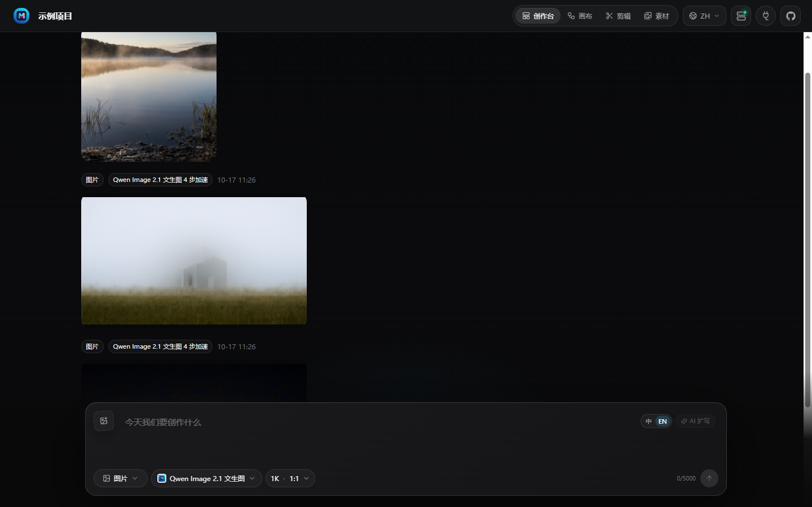
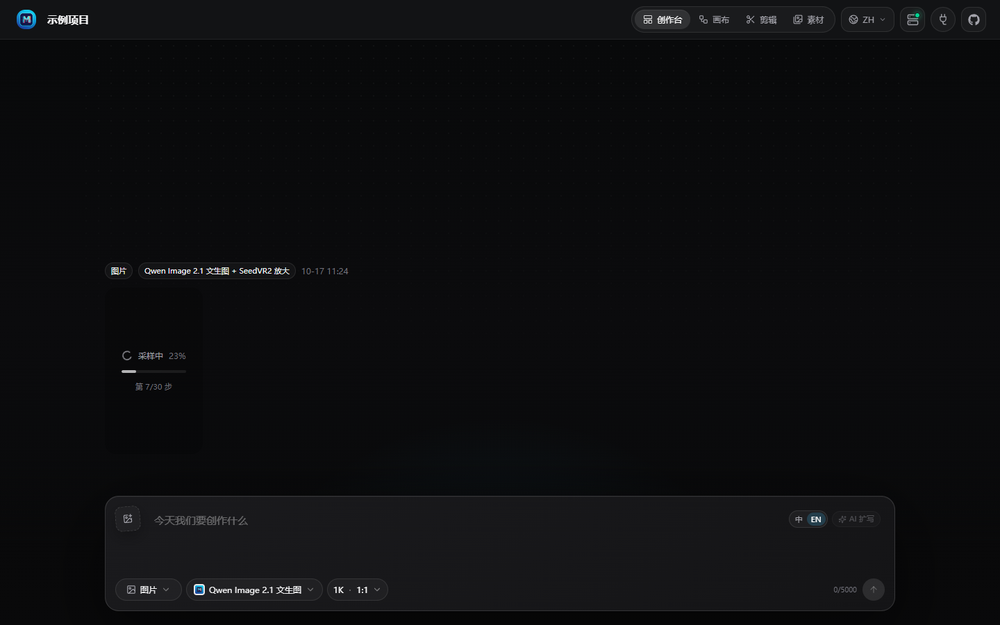
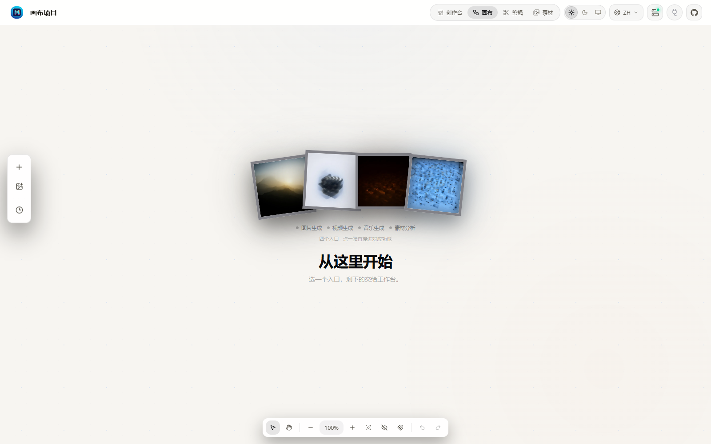
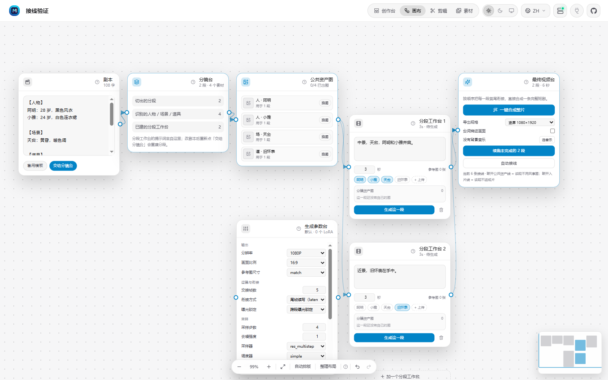
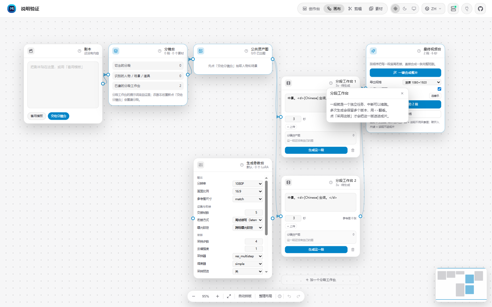
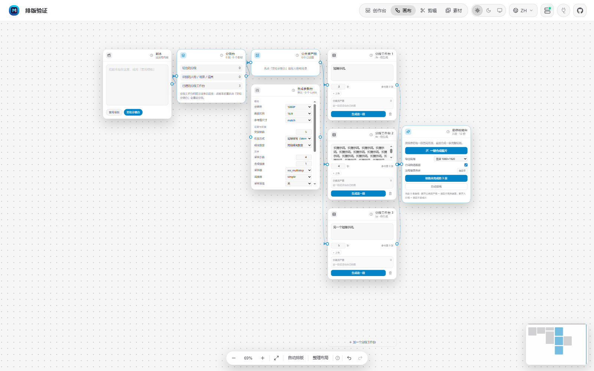
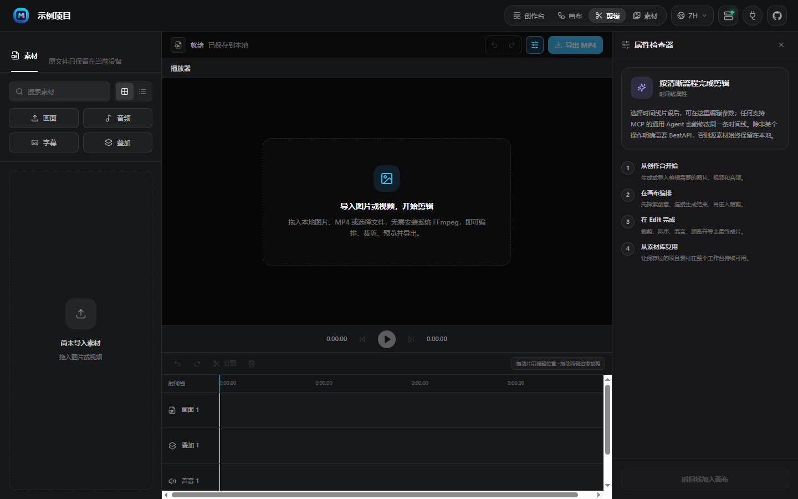
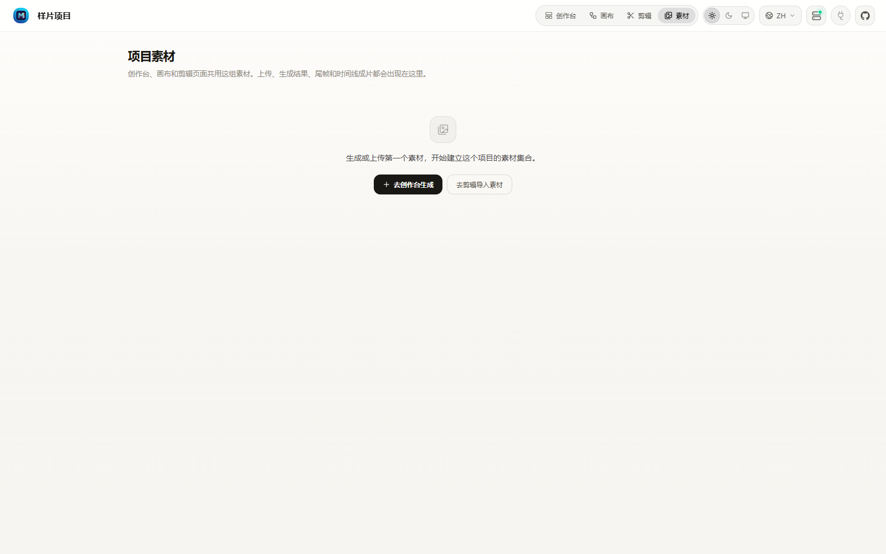

# Manke Workbench (漫客工作台)

**A local-first image and video creation workbench for ComfyUI.**

Everything runs against your own ComfyUI instance — no account, no API key, no
asset ever leaves your machine. All views share one local project.

Beyond single images and clips it ships an **AI short-drama pipeline**: script →
portrait → shot by shot → subtitles → music → vertical film, resumable, and
generation never overwrites a previous take.



> This is a fork of [BeatDesign](https://github.com/BeatAPI/BeatDesign)
> (Apache-2.0). See [NOTICE](NOTICE) for the list of changes.
> The full documentation is written in Chinese: [README.md](README.md).

---

## What it is

ComfyUI is powerful but awkward as a daily tool: the workflow is a graph rather
than an intent, results scatter across the output folder, and once execution
starts all you have is a scrolling log.

This workbench splits those concerns:

| Need | How |
| --- | --- |
| Describe intent, not nodes | **Studio** — pick a model, write a prompt, adjust a few parameters |
| Compose visually | **Canvas** — lay out assets and generation nodes, connect what references what |
| Keep results | Every generation is recorded in the project database; outputs land in `data/project-assets/` |
| See the process | Step counts are read from ComfyUI's WebSocket and shown as `step 7/30` |

The workflows are **not** hidden behind an abstraction. Each model is an ordinary
ComfyUI API-format JSON in `data/comfyui/workflows/` — change the JSON, change the
behaviour, no code required.

## Four views

### Studio



Prompt-driven generation with a feed of past results. Each entry carries the model
used and a timestamp; clicking a chip restores that run's prompt and parameters.



While a job runs the feed shows the live stage and step counter — read from
ComfyUI's `progress` events over the WebSocket, not estimated from elapsed time.

### Canvas



An infinite canvas where nodes are assets or generation tasks, and edges express
reference relationships. Generated images can be pulled back in from the history
panel and composed further.

### AI short-drama canvas

Picking **AI short drama** when creating a canvas project opens a dedicated
pipeline: script on the left, cast and settings in the middle, one workbench per
shot, and the final cut on the right. Nodes are工序, not just references — you
write the script and work down the columns.



| Node | Role |
| --- | --- |
| Script | Write `[cast] / [scene] / [shot N]`, then hand it to the board |
| Storyboard | Shows the shots cut and the cast recognised |
| Shared assets | Upload a portrait per character — **this is what keeps faces stable** |
| Settings | Resolution, sampling, LoRA, prompt reinforcement |
| Shot workbench | One shot = one job; every take is kept |
| Final cut | Resume, join, burn subtitles, mix music, pick export size |

Every node header has a **?** that opens a floating help card, portalled to
`body` so it does not shrink with the canvas zoom.



**Consistency** comes from reference images, not prose: a shot inherits whoever
its prompt names, assets with an image become references, and the prompt carries
`<Subject N> is the person in <Picture N>, keep face, hair, costume and build`.
Six shots from one portrait produced the same face throughout.


**Resumable runs.** One shot is one ComfyUI job, persisted as soon as it lands,
so a failure at shot 30 no longer throws away thirty minutes: resume only renders
what is missing, retry only what failed, and a page refresh loses nothing.

**Versioning.** Generating again never overwrites: every take is kept (five max),
flip through them with `‹ 2/3 ›`, and only the take you adopt enters the film.

**Wires carry meaning.** Cut `assets → shot` and that shot stops using the shared
face; cut `shot → final` and it leaves the cut.

**Subtitles** are extracted from the `<d>` tags the shots already carry, timed by
shot duration, written as ASS with PlayRes matching the export size, and burned
after scaling. Turning subtitles on also suppresses the model painting dialogue
into the frame, which would otherwise give two captions.


**Export** offers as-rendered, vertical 1080x1920 (default), vertical 720x1280,
square and landscape, filling the frame and centre-cropping so a vertical cut has
no bars. Plain joining uses `-c copy`; subtitles or music switch to libx264/aac.

**Canvas controls.** Right-drag, middle-drag, space+drag or the wheel pans;
ctrl+wheel zooms; `Shift+1` or a double-click fits; drag empty space to select,
`Delete` removes, `Esc` clears, `ctrl+A` takes all; auto-arrange lays the board out
in five columns spaced by real card heights.



---

### Editor



A browser-native timeline with picture, overlay, subtitle and audio tracks.
Drag in images or MP4, trim, order, preview, and export MP4 — encoding happens in
the browser, so **no system FFmpeg is required**.

### Assets



One library for everything the project produced, grouped by media type. Items can
be downloaded, added back to the canvas, or sent to the timeline.

## How a generation runs

The screenshot above is a real run of `Qwen Image 2.1 + SeedVR2 upscale`, showing
`sampling 23% · step 7/30`. Behind it:

1. **Submit** — the UI posts prompt, model id and parameters to
   `/api/effects/generate`. The server preflights them: unsupported parameters or
   references from another project stop the request before any work starts.
2. **Translate** — the adapter loads `data/comfyui/workflows/<model id>.json`, an
   API-format graph (node id → class + inputs), and writes the prompt, size and
   seed into the right `inputs`. Every other edge is left untouched.
3. **Hand off** — the graph is POSTed to ComfyUI's `/prompt` with a fixed
   `client_id`. ComfyUI returns a `prompt_id`, the handle for everything that
   follows. That `client_id` matters: ComfyUI routes progress events to the socket
   registered under it, so a socket connected with any other id receives nothing.
4. **Execute** — ComfyUI loads models, encodes text, samples, decodes, upscales and
   saves, emitting `{"type":"progress","data":{"value":7,"max":30,…}}` as it goes.
5. **Report** — a resident WebSocket keeps `value/max` per `prompt_id`; the UI
   polls the list every 2.5 s and renders the bar. Stage names are inferred only
   from reliable signals — `progress` comes from sampling nodes, so "sampling" is
   trustworthy, and everything else says "preparing" rather than guessing.
6. **Persist** — on completion the adapter reads `/history/<prompt_id>`, downloads
   the outputs into `data/project-assets/`, and records model, prompt, parameters
   and timing in the project database. Close the browser and the history is still
   there.

## Quick start

Requirements: Node.js ≥ 22 (needs the built-in `WebSocket`), pnpm ≥ 10, and a
reachable ComfyUI (default `http://127.0.0.1:8188`).

```bash
git clone https://github.com/caizongfei41/manke-workbench.git
cd manke-workbench
pnpm install
# edit data/comfyui.config.json to point at your ComfyUI
pnpm build
pnpm start          # http://127.0.0.1:3020
```

The bundled workflow templates expect specific ComfyUI custom nodes and model
weights (Qwen Image 2.1, Flux.2 Klein, MiniMax H3, SeedVR2, DLSS …). Those are not
vendored here; a model whose nodes are missing is reported as unavailable rather
than failing silently. Run `node scripts/validate-templates.mjs` to check your
environment.

On Windows there is also a one-click launcher (`启动工作台.bat`) and a GUI service
console (`服务控制台.bat`); `launcher/tasks-example/` holds sanitised scheduled-task
definitions for running both as background services.

## Development

```bash
pnpm dev            # dev server with HMR
pnpm typecheck
pnpm test
pnpm i18n:check
pnpm build
```

Useful maintenance scripts:

```bash
node scripts/validate-templates.mjs         # check templates against your ComfyUI
node scripts/run-template.mjs <template>    # run one template and wait for output
node scripts/sweep-templates.mjs            # run all templates, report timings
node scripts/clean-caches.mjs               # clean rebuild (rules out stale caches)
node scripts/audit-publication.mjs .        # scan for secrets / paths / large files
```

## Licence and provenance

- Code: [Apache License 2.0](LICENSE).
- Forked from **BeatDesign**, Copyright 2026 BeatAPI. Modifications are listed in
  [NOTICE](NOTICE) as required by section 4(b) of the licence.
- "BeatDesign" and "BeatAPI" are trademarks of BeatAPI; they appear here only to
  describe the origin of this work. This fork is not endorsed by or affiliated
  with BeatAPI. See [docs/TRADEMARKS.md](docs/TRADEMARKS.md).
