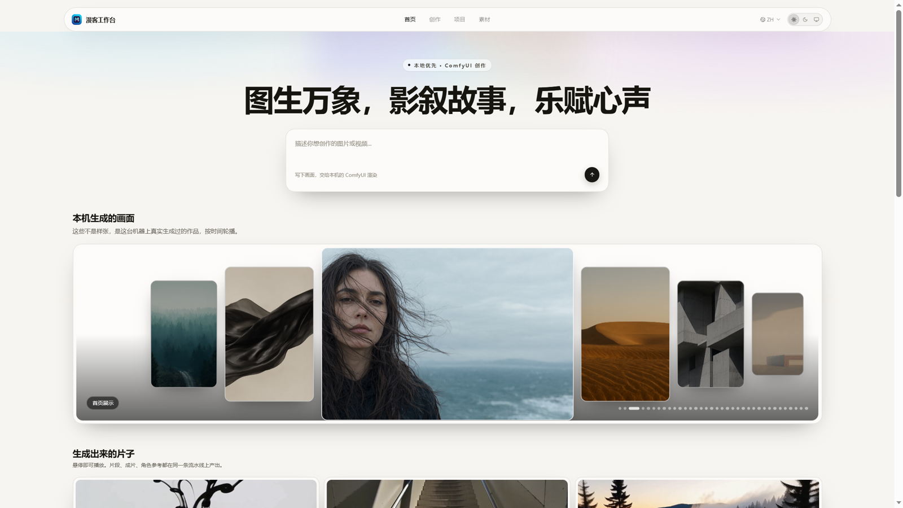
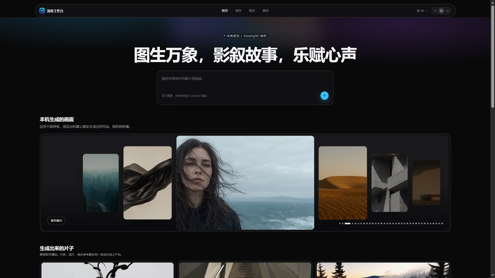
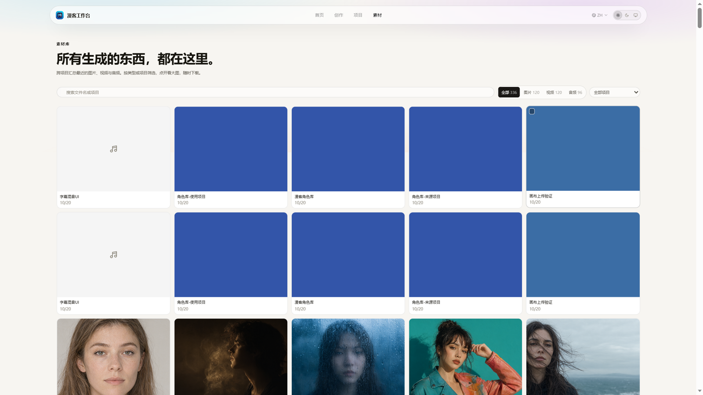
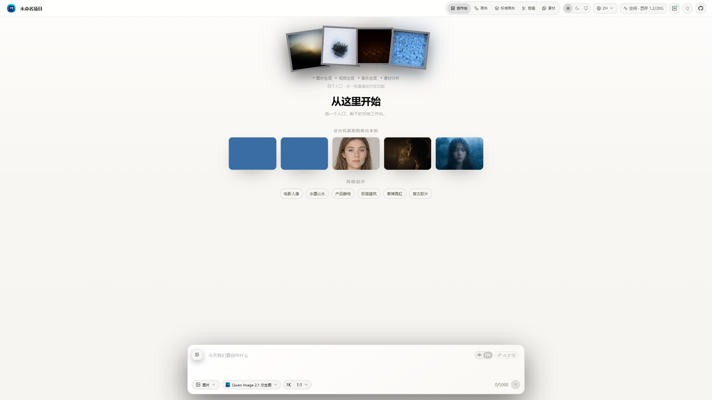
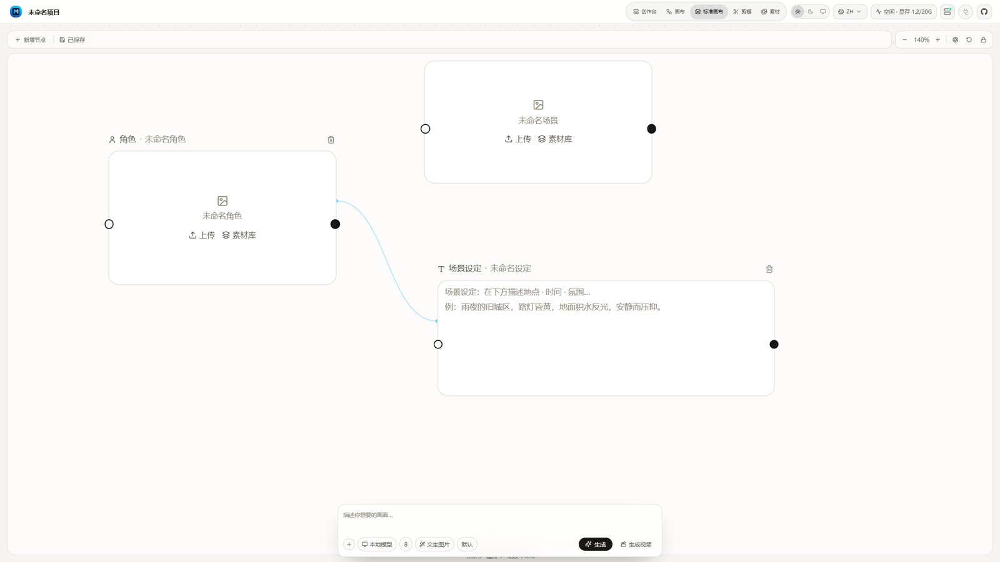
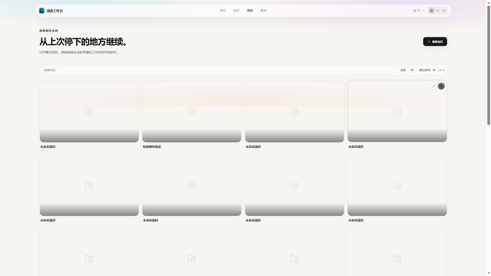

# 漫客工作台

**本地优先的 ComfyUI 图像、视频与音乐创作工作台** —— 化繁为简，自由创作。

模型跑在你自己的机器上，不经过任何云端服务：没有账号，没有 API Key，素材不出本机。
所有视图共用同一份本地项目数据。

除了单张出图和片段生成，它还内置一条 **AI 短片流水线**：写剧本 → 定角色 → 逐段生成 →
烧字幕 → 混 BGM → 竖屏成片。中断可续跑，生成不覆盖旧版本。

界面提供**浅色 / 深色 / 跟随系统**三种主题，切换即时生效并被记住——深色看图不刺眼，
浅色写提示词更舒服。



---

## 上手

不想读源码，只想用起来？看这份：

> **[漫客工作台 · 完整图文教程](docs/漫客工作台-完整图文教程.pdf)**（20 页）
>
> 下载 → 安装控制台 → 解压部署 → 首次启动 → 每个功能怎么用 → 常见问题。
> 带截图，照着做就行。

**部署包**（211 GB，含便携 Python、26 个模型、13 个节点包）：
[夸克网盘 `manke-big`](https://pan.quark.cn/s/8d1ed42563d4)　口令 `~9d1f3bt6QP~:/`

**控制台安装包**（25.7 MB）：`dist/漫客工作台控制台-Setup/漫客工作台控制台-Setup.exe`

---

## 它长什么样

### 首页 · 深色

轮播里的每一张都是这台机器真实渲染过的作品。中间一张主图，两侧逐级收窄成扇形，随页翻动。



### 素材库

跨项目汇总所有生成的图片、视频与音频。按类型或项目筛选，点开看大图，随时下载。



### 创作台

写一句话就能开始。模型、比例、时长收在同一条工具条上，结果直接进入项目素材。



### 标准画布

卡片式节点工作区：角色、场景、设定三类卡片，连线决定谁参与生成。角色卡上的参考图会随连线
进入生成流程，设定卡的文字构成提示词。



### 项目列表



---

## 核心能力

| 模块 | 说明 |
|---|---|
| **图像生成** | 文生图；带参考图的编辑工作流 |
| **视频生成** | H3 长视频工作流，按段生成，可续跑 |
| **音乐生成** | 本地 YuE2 模型 |
| **标准画布** | 卡片节点编辑，连线即参考，一键出图或出片 |
| **短片流水线** | 剧本 → 分镜 → 逐段生成 → 字幕 → 混音 → 成片 |
| **剪辑台** | 时间线编辑，多轨（画面/叠加/字幕/声音），导出 MP4 |
| **素材库** | 跨项目汇总，筛选、预览、下载 |
| **回收站** | 删除进回收站而不是直接消失，可查可恢复 |

### 一条真实的短片是怎么跑出来的

仓库里附带一份完整案例：[`docs/projects/消失的凶手-剧本.md`](docs/projects/消失的凶手-剧本.md)，
5 分钟悬疑短剧，55 段分镜。

剧本格式是短剧模式直接吃的：

```
【第12段｜5秒】
integrated_multimodal_description: [Shot 12] narrow corridor at night,
  medium shot 50mm, 周砚 is <Picture 1>, at a dark wooden door
0.0～1.5秒：他抬起右手准备敲门。
1.5～3.2秒：敲了两下，声音闷在走廊里。
3.2～5.0秒：手收回身侧。

overall_soundscape: 指节敲门的闷响，雨声隔着墙
non_diegetic_music: N/A
```

要点：

- `【第N段｜X秒】` 是分段的唯一依据，一段 3–8 秒
- `<Picture 1>`–`<Picture 8>` 绑定定妆照，**这是人物一致的关键**——
  三张定妆照全程挂着，同一个角色才不会每段换一张脸
- 对白只写在 `<d>[Chinese] …</d>` 里，一个段落一个说话人
- 每段都要有 `overall_soundscape`，否则环境音会断

把剧本贴进短剧模式，点「交给分镜台」会自动切段、识别角色场景道具，
给每段建生成工作台，然后逐段生成、一键合成。

---

## 技术栈

- **框架**：TanStack Start + React 19，文件式路由
- **样式**：Tailwind v4（CSS-first，`@theme inline`），设计 token 驱动双主题
- **数据**：SQLite / libsql + Drizzle
- **国际化**：Paraglide（中文 / English / 日本語）
- **生成后端**：本地 ComfyUI（默认 `127.0.0.1:8188`）
- **测试**：node:test 单元测试 + CDP 驱动的端到端验证套件

---

## 快速开始

### 前置

| 项目 | 要求 | 说明 |
|---|---|---|
| Node.js | 20+ | |
| **pnpm** | 9+ | 项目用 pnpm，不认 npm 的锁文件 |
| **ComfyUI** | 本地运行，能开 `127.0.0.1:8188` | |
| **模型** | 约 230 GB | **不在仓库里**，见[模型不随仓库分发](#模型不随仓库分发) |
| **自定义节点** | 13 个包 | 见[自定义节点](#自定义节点) |
| 显卡 | 20 GB 显存起步 | 720P 视频约需 17 GB；1080P 建议 24 GB |
| 系统 | Windows | 当前主要开发平台，Linux/macOS 未验证 |

> 只有图像功能的话门槛低很多：一张 8 GB 卡 + Qwen-Image 2.1 的 Q6 量化版就够。
> 视频和音乐才需要上面那套大模型。

### 安装

```bash
git clone git@github.com:caizongfei41/manke-workbench.git
cd manke-workbench

pnpm install
pnpm db:push        # 初始化本地数据库
pnpm dev            # http://127.0.0.1:3000
```

生产构建：

```bash
pnpm build
PORT=3020 BEATDESIGN_GENERATION_PROVIDER=comfyui pnpm start
```

### 装完先核对模型

```bash
node scripts/fetch-models.mjs
```

不报缺就说明工作流需要的模型都到位了。缺什么会直接列出来。

### 一条命令拉起整套环境

```bash
pnpm stack:up
```

会检查并启动 ComfyUI、工作台本身，以及端到端验证用的浏览器调试端口。

---

## 工作流与模型

工作流放在 `data/comfyui/workflows/`，**文件名就是模型 id**。

```
小枫-qwen-image-2-1-文生图.json      文生图
小枫-qwen-image-2-1-图像编辑.json    带参考图的编辑（声明了 image / multi_image）
小枫-无限分段生视频.json             短剧模式的默认生成器
小枫-aicg3d-h3-长视频.json           视频
```

工作流里的 `_beatdesign` 元数据告诉适配器往哪些节点注入：

```json
{
  "_beatdesign": {
    "positive": "4",       // 提示词节点
    "seed": "7",           // 随机种子
    "size": "6",           // 尺寸
    "image": "476",        // 参考图输入（仅编辑类工作流）
    "multi_image": "476"
  }
}
```

> `image_urls` 只对声明了 `image` / `multi_image` 的模板有意义；
> 文生图模板会静默忽略它，所以带参考图时模型会自动切到编辑工作流。

### 模型不随仓库分发

**这一点必须先说清楚：仓库里没有模型权重，一个都没有。**

全部模型合计 **230 GB 以上**（最大的单个主模型 32 GB），GitHub 单文件上限是 100 MB，
放不进 Git，用 LFS 也不现实（免费额度 1 GB/月）。

**但整套环境有现成的部署包，不用一个一个去搜。**

### 一键部署包（推荐）

7 个包 / 211.1 GB，含**模型 + 13 个节点包 + 工作台源码**，目录结构已对齐：

> **链接**：https://pan.quark.cn/s/8d1ed42563d4
>
> 或打开夸克 APP 复制这段：`~9d1f3bt6QP~:/`

| 分卷 | 内容 | 大小 |
|---|---|---|
| `01-models.7z.001 … .113` | 25 个模型权重 | 196.9 GB |
| `02-nodes.7z.001` | 13 个自定义节点包 | 264 MB |
| `03-app.7z.001` | 工作台源码 | 13 MB |

**全部下齐再解压**，只点 `.001`，7-Zip 会自动接续后面的分卷。

### 部署三步

```
1. 解压 03-app → 比如 D:\manke-workbench
2. 把整个部署包目录拷到 D:\manke-workbench\deploy\
3. 打开「漫客工作台 控制台」→ 检查部署包 → 一键部署
```

控制台会自动解压模型和节点到 ComfyUI 对应位置，然后把环境自检跑一遍。

收尾：

```bash
pnpm install && pnpm db:push && pnpm build
node scripts/check-environment.mjs   # 看到 "30 / 30 就位" 就成功了
```

### 手工部署

不想用控制台的话：

```powershell
# 节点 + 模型 → ComfyUI 根目录
7z x 02-nodes.7z.001 -o"<ComfyUI 根>"
7z x 01-models.7z.001 -o"<ComfyUI 根>"
# 源码 → 你想放的地方
7z x 03-app.7z.001 -o"D:\manke-workbench"
```

### 只想要模型

部署包里有完整的 `README-必读.md`，包含显存选型、常见问题、校验清单。
包里还附了 `校验清单.md`（119 个分卷的 SHA256），解压失败时能定位坏卷。

这一版按 **20 GB 显存**（RTX 3080 级别）配的，720P 视频能跑通。
显存更小的机器见 [`docs/DEPENDENCIES.md`](docs/DEPENDENCIES.md) 的「按显存选模型版本」。

### 或者自己逐个下

仓库提供三样东西，配合使用：

1. 工作流 JSON —— 决定了需要哪些模型
2. 完整依赖清单 —— [`docs/DEPENDENCIES.md`](docs/DEPENDENCIES.md)，含每个文件的真实相对路径、大小与下载渠道
3. 核对脚本 —— `scripts/fetch-models.mjs`，告诉你现在还缺什么

### 检查缺什么

```bash
# 1. 先核对：当前缺哪些、该放哪、多大
node scripts/fetch-models.mjs

# 2. 输出一份带路径的清单，照着往里放
node scripts/fetch-models.mjs --write
# → .verify/models-checklist.md
```

脚本默认找 `E:\ComfyUI\ComfyUI`，换机器时用环境变量或参数指定：

```bash
node scripts/fetch-models.mjs --write "D:\ComfyUI"
# 或
BEATDESIGN_COMFYUI_HOME="D:\ComfyUI" node scripts/fetch-models.mjs
```

输出长这样：

```
ComfyUI: E:\ComfyUI\ComfyUI
模板引用模型 33 个
已安装 33 个，合计 234.8 GB
没有缺失
```

缺文件时会逐个列出文件名和用到它的工作流。

### 模型从哪来

这台机器上的模型来自这几类来源，按工作流分组：

| 用途 | 模型 | 大小 | 大致来源 |
|---|---|---|---|
| **视频主模型** | `Minimax-h3_Singularity_ref2va_v1.3_int8` | 31.7 GB | ModelScope / HuggingFace 的 MiniMax H3 社区量化版 |
| | `minimax_h3_ref2va_pruned_int8_convrot` | 19.5 GB | 同上，剪枝加速版 |
| | `minimax_h3_hybrid_fl2va_ref2va_b25-49-int8` | 19.5 GB | 同上，混合版 |
| **文本编码器** | `qwen3vl_32b_minimax_h3_nvfp4_awq` | 14.6 GB | Qwen3-VL 32B 的 H3 适配量化版 |
| | `qwen3vl_8b_int8_convrot` | 8.7 GB | Qwen3-VL 8B，图像工作流用 |
| **VAE** | `minimax_h3_video_vae_fp16` | 4.9 GB | MiniMax H3 官方 |
| | `minimax_h3_audio_vae_fp32` | 577 MB | 同上 |
| **加速 LoRA** | `minimax_h3_DMAD_4step` | 350 MB | DMAD 4 步蒸馏 LoRA |
| | `minimax_h3_fl2v_turbo_8step` | 1.8 GB | Turbo 8 步 |
| **图像模型** | `flux-2-klein-base-9b-fp8` | 8.9 GB | Black Forest Labs Flux.2 Klein |
| | `qwen-image-2.1-Q8_0.gguf` | 7.1 GB | Qwen-Image 2.1 社区量化 |
| **音乐模型** | `yue2_3b_bf16` | 7.3 GB | YuE2 |
| **放大** | `seedvr2_ema_3b_fp8_e4m3fn` | 3.2 GB | SeedVR2 |

完整 33 项见 [`docs/DEPENDENCIES.md`](docs/DEPENDENCIES.md)。

> 这些是社区量化版，同一个模型常有多个作者的不同量化（int8 / nvfp4 / gguf）。
> **模板里写死了文件名**，换文件名就得同步改工作流 JSON，或者做个软链接。

### 自定义节点

工作流依赖 13 个自定义节点包，装到 `ComfyUI/custom_nodes/` 下：

```bash
cd ComfyUI/custom_nodes
git clone https://github.com/<author>/ComfyUI-AICG3D-Integrated
git clone https://github.com/<author>/ComfyUI_MiniMaxH3_Director
# ... 其余见 docs/DEPENDENCIES.md
```

关键的一个是 `ComfyUI-AICG3D-Integrated`，它提供 H3 系列的核心节点
（`AICG3D_H3Loader`、`AICG3D_H3SequenceGlobal`、`AICG3D_H3SequenceSegment`、
`AICG3D_H3SequenceCombine`），无限分段生视频就靠这几个。

### 显存怎么规划

这套工作流在 20 GB 显存（RTX 3080）上的实测数据：

| 分辨率 | 单段 token | 单段耗时 | 显存峰值 |
|---|---|---|---|
| 720P | 约 40,000 | 3–4 分钟 | 17 GB |
| 1080P | 约 88,000–115,000 | 8–9 分钟 | 顶到边界 |

token 数大约等于 `秒数 × 14000`。20 GB 卡的安全线在 6 万 token 左右，
所以默认分辨率给的是 **720P** —— 先保证跑得完，要细节再往上调。

「显存档位」是第二道闸：选「12G」会把画布封顶 720P，「8G」封顶 480P。
要在 20 GB 卡上跑 1080P，得把档位手动设成「16G」。

---

## 验证

每个界面行为都有对应的验证套件，直接驱动真实浏览器去测量，而不是读代码猜。

```bash
pnpm test           # 单元测试
pnpm verify:ci      # 端到端套件（不需要 GPU）
pnpm verify:gpu     # 需要 ComfyUI 的生成类套件
pnpm verify:all     # 全部
```

单套运行：

```bash
pnpm verify:one standard-canvas
```

验证脚本在 `scripts/e2e/`，标注 `// @needs: comfyui` 的套件需要本地模型服务。

---

## 项目结构

```
src/
  components/
    marketing/        首页、外壳、展示轮播
    studio/           创作台
    beatcanvas/       画布基础组件
    standard/         标准画布
    drama/            短片流水线
    assets/           素材库
    app/              工作台外壳与路由装配
  core/
    adapters/         ComfyUI 适配器
    effects/          生成提交、状态轮询
    standard-canvas/  画布文档模型
    showcase/         首页展示策展逻辑
    projects/         项目与快照
  routes/             文件式路由（含 /api）
  styles/             设计 token 与全局样式
scripts/
  e2e/                端到端验证套件
  generate-showcase*  首页展示素材生成
data/
  comfyui/workflows/  ComfyUI 工作流
  project-assets/     项目素材
  trash/              回收站
```

---

## 数据与隐私

- 生成、素材、项目数据全部在本机
- 不上传云端，不需要账号
- 删除先进回收站（`data/trash/`），可审计
- 隐私相关的操作不产生任何外部请求

---

## 关于

漫客工作台基于 [BeatDesign](https://github.com/Scenth/BeatDesign) 二次开发，在原有画布体验之上
增加了本地 ComfyUI 提供方、标准画布、短片流水线与一套完整的双主题设计系统。

## 许可证

MIT
