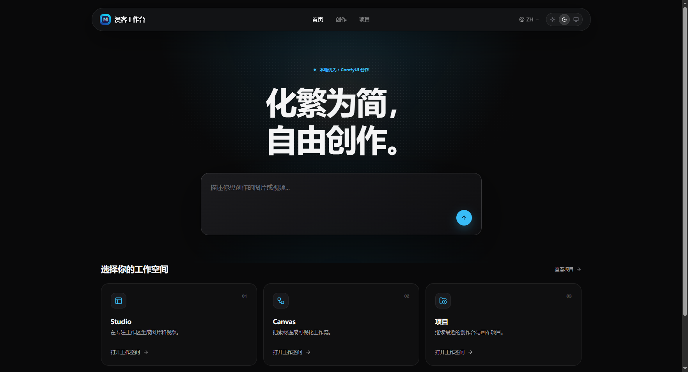
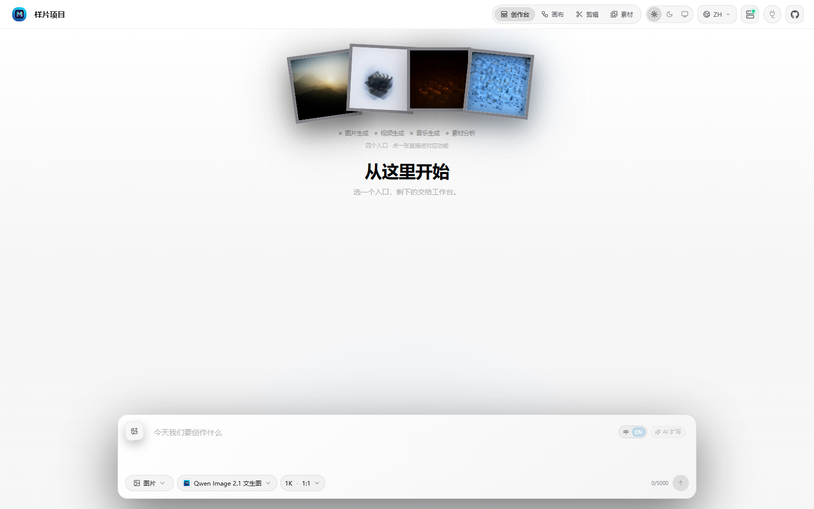
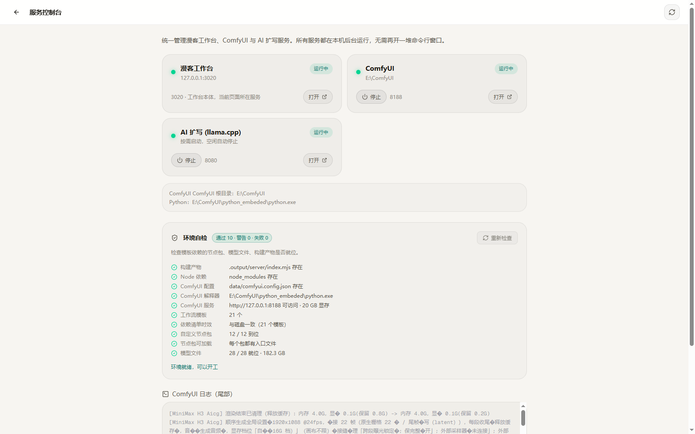

# 漫客工作台

**本地优先的 ComfyUI 图像、视频与音乐创作工作台** —— 化繁为简，自由创作。

模型跑在你自己机器的 ComfyUI 上，不经过任何云端服务：没有账号，没有 API Key，
素材不出本机。所有视图共用同一份本地项目数据。

界面提供**浅色 / 深色 / 跟随系统**三种主题，切换即时生效并被记住 —— 深色看图和
视频不刺眼，浅色写提示词更舒服。


> 本项目是 [BeatDesign](https://github.com/BeatAPI/BeatDesign)（Apache-2.0）的分支，
> 加了完整的本地 ComfyUI 生成链路、逐步骤进度显示、中文化界面和 Windows 部署工具。
> 详见 [NOTICE](NOTICE) 与 [许可证与来源](#许可证与来源)。

---

## 目录

- [它解决什么问题](#它解决什么问题)
- [浅色 / 深色主题](#浅色--深色主题)
- [四个视图](#四个视图)
- [一次生成是怎么走完的](#一次生成是怎么走完的)
- [快速开始](#快速开始)
- [支持的模型](#支持的模型)
- [服务管理](#服务管理)
- [架构与目录结构](#架构与目录结构)
- [开发](#开发)
- [常见问题](#常见问题)
- [平台兼容性](#平台兼容性)
- [许可证与来源](#许可证与来源)

---

## 它解决什么问题

ComfyUI 很强，但直接用有三个门槛：

1. **工作流是图，不是意图。** 想改一个分辨率，得在一堆节点里找到那个数字。
2. **结果散落。** 生成的图在 `output/` 目录里，提示词在脑子里，两次生成的参数对不上。
3. **过程不可见。** 点了执行之后只有日志在滚，不知道还要等多久。

漫客工作台把这三件事分开处理：

| 问题 | 做法 |
| --- | --- |
| 想描述意图而不是连节点 | 创作台：选模型、写提示词、调几个参数就能出图 |
| 需要可视化编排 | 画布：把素材和生成节点摆开，连线表达「谁是谁的参考」 |
| 结果需要沉淀 | 每个生成都记进项目数据库，产出落到 `data/project-assets/`，随时复用 |
| 过程要看得见 | 通过 ComfyUI 的 WebSocket 拿到采样步数，界面显示「第 7/30 步」 |

**工作流本身没有被封装掉。** 每个模型就是一个标准的 ComfyUI API 格式 JSON，
放在 `data/comfyui/workflows/`。想改行为，改 JSON，不用写代码。

---

## 浅色 / 深色主题

顶栏的太阳 / 月亮 / 显示器三个按钮分别对应浅色、深色、跟随系统。选择存在浏览器本地，
刷新和下次打开都保持；首帧渲染前就已经应用，不会先闪一下深色再切过去。

| 浅色 | 深色 |
| --- | --- |
|  |  |

两套主题共用同一组语义色（`--beat-ink` 在深色下是白、浅色下是近黑），所以组件不需要
为两套模式各写一份样式。画布的点阵是 React Flow 用 canvas 画的，不走 CSS，因此它的
`colorMode` 单独跟随文档主题。

---

## 四个视图

四个视图是同一份项目数据的四种看法，顶栏随时切换，不会丢状态。

### 创作台 — 专注生成



空项目时给出四张风格缩略图作为起点。点一下会把对应的提示词填进输入框
（在画布上则是直接用该提示词开一张草稿卡片）。

生成完成后，结果按时间排列在同一个流里：


每条记录带三样东西：**用了哪个模型**、**什么时候生成**、**结果本身**。
点标签可以把那次的提示词和参数重新灌回输入框，改一改再生成。

底部输入区：

| 控件 | 作用 |
| --- | --- |
| 图片 / 视频 | 切换生成类型，模型列表随之过滤 |
| 模型选择 | 只显示当前 ComfyUI 环境里可用的模型 |
| 尺寸比例 | 例如 `1K · 1:1`，选项随模型能力变化 |
| 中 / EN | 提示词语言，影响「AI 扩写」的输出语言 |
| AI 扩写 | 把短提示词扩写成完整描述（走本地 llama.cpp 或云端） |
| 上传图片 | 挂参考图，用于图生图 / 图编辑类模型 |

### 画布 — 可视化编排


无限画布，节点是素材或生成任务，连线表示引用关系。

左侧工具条三件事：**生成节点**（开一张新的生成卡片）、
**上传素材**（拖本地文件进来）、**历史素材**（把已生成的成果插回来）。

顶部工具条：选择 / 平移 / 缩放 / 适配全部节点 / 隐藏连接线 / 网格吸附 / 撤销重做。

生成卡片打开后是一个完整的编辑器：模型、提示词、尺寸、参考图都在卡片内部，
生成结果直接落在卡片里，可以继续往下游连。

### 剪辑 — 时间线


浏览器原生的时间线编辑器，**不需要装系统 FFmpeg**。四条轨道：画面、叠加、字幕、声音。

可以拖入本地图片 / MP4，裁剪、排序、预览，最后导出 MP4，编码直接在浏览器里完成。

### 素材 — 统一资产库


创作台生成的、画布上用的、剪辑里产出的，全都在这里。图片 / 视频 / 音频分组展示，
可以下载、加回画布、或送进时间线。

---

## 一次生成是怎么走完的


上面这张是**真实运行中的截图**：模型是 `Qwen Image 2.1 文生图 + SeedVR2 放大`，
界面显示「采样中 23% · 第 7/30 步」。下面是它背后发生的事。

### 1. 提交

界面把「提示词 + 模型 id + 参数」打包成一次生成请求，POST 到 `/api/effects/generate`。
后端先做预检：参数是否该模型支持、参考图是否属于本项目，不通过就不会往下走。

### 2. 翻译成工作流

`comfyui-adapter` 按模型 id 载入对应的模板：

```
data/comfyui/workflows/<模型 id>.json
```

模板是 ComfyUI 的 **API 格式**（不是界面格式），就是一张「节点 id → 类名 + 输入」的表。
适配器把请求里的提示词、尺寸、种子等写进指定节点的 `inputs`，其余节点的连线原样保留。

> 这一步就是「改模板即改行为」的落点：想换采样器、加一个后处理节点，
> 在 ComfyUI 里导出新的 API JSON 覆盖上去就行。

### 3. 交给 ComfyUI

适配器把节点表 POST 到 ComfyUI 的 `/prompt`，并带上固定的 `client_id`。
ComfyUI 返回一个 `prompt_id`，这是后续跟踪任务的凭据。

**这个 `client_id` 很关键。** ComfyUI 的进度事件是定向发给提交时那个 `client_id`
对应的 socket 的 —— 换个 id 连上去，连接成功但收不到任何消息。
所以适配器和进度模块共用同一个常量（`COMFYUI_CLIENT_ID`）。

### 4. 执行

ComfyUI 按依赖顺序执行：加载模型 → 文本编码 → 采样 → 解码 → 放大 → 保存。
每完成一步，采样节点通过 WebSocket 推一条：

```json
{"type":"progress","data":{"value":7,"max":30,"prompt_id":"…","node":"6"}}
```

### 5. 进度回传

`comfyui-progress.ts` 常驻一条 WebSocket，按 `prompt_id` 记下 `value/max`。
界面每 2.5 秒轮询一次列表接口，把进度画成进度条。

阶段名是按已知信号推断的 —— `progress` 只会由采样节点发出，所以「采样中」可靠；
没收到事件时显示「准备中」，不猜。

### 6. 落盘与记录

ComfyUI 执行完后，适配器从 `/history/<prompt_id>` 拿到产物清单，
把文件下载到 `data/project-assets/<项目 id>/`，同时把这次生成的
`模型 / 提示词 / 参数 / 产物路径 / 耗时` 写进项目数据库。

所以**关掉浏览器再打开，历史还在**；换台机器把 `data/` 拷过去，项目也能继续。

---

## 快速开始

### 前置条件

| 依赖 | 版本 | 说明 |
| --- | --- | --- |
| Node.js | ≥ 22 | 需要内置的 `WebSocket`（进度功能依赖） |
| pnpm | ≥ 10 | `npm i -g pnpm` |
| [ComfyUI](https://github.com/comfyanonymous/ComfyUI) | 0.3.x 以上 | 本机或局域网可达，默认 `http://127.0.0.1:8188` |

### 关于模型与自定义节点

仓库自带 16 个工作流模板，但它们依赖具体的 ComfyUI 自定义节点和模型权重
（Qwen Image 2.1、Flux.2 Klein、MiniMax H3、SeedVR2、DLSS 等）。
这些**不在本仓库内**，需要你自己在 ComfyUI 里装好。

缺节点时对应模型会标记为不可用，不会静默失败。逐个检查环境是否匹配：

```bash
node scripts/validate-templates.mjs
```

### 安装

```bash
git clone https://github.com/caizongfei41/manke-workbench.git
cd manke-workbench
pnpm install
```

### 指向你的 ComfyUI

首次启动会生成 `data/comfyui.config.json`，按自己的环境改：

```json
{
  "baseUrl": "http://127.0.0.1:8188",
  "workflowDir": "comfyui/workflows",
  "pythonPath": "E:\\ComfyUI\\python_embeded\\python.exe"
}
```

| 字段 | 说明 |
| --- | --- |
| `baseUrl` | ComfyUI 地址，可以指向局域网内另一台机器 |
| `workflowDir` | 工作流模板目录，**相对 `data/` 解析**，也可以写绝对路径 |
| `pythonPath` | 仅 Windows 便携版需要，用来由工作台启动 / 停止 ComfyUI |

### 启动

**方式一：命令行**

```bash
pnpm build
pnpm start          # http://127.0.0.1:3020
```

**方式二：Windows 启动器**

双击根目录的 `启动工作台.bat`。它会检查 Node 与构建产物、清理 ComfyUI 残留进程、
拉起 ComfyUI、拉起工作台、等端口就绪，最后打开浏览器。已经跑着的端口会跳过，可重复执行。

**方式三：桌面控制台**

双击 `服务控制台.bat`（或桌面快捷方式），得到一个可视化面板：



---

## 支持的模型

定义在 `src/core/effects/effect-registry.ts`，每个对应 `data/comfyui/workflows/` 下的一个 JSON。

| 类型 | 模型 | 依赖的 ComfyUI 侧组件 | 参考耗时 |
| --- | --- | --- | --- |
| 图像 | Qwen Image 2.1 文生图 | Qwen Image 2.1 权重 + 文本编码器 | ~90s |
| 图像 | Qwen Image 2.1 图像编辑 | 同上 | ~125s |
| 图像 | Qwen Image 2.1 文生图 / 图编辑（4 步加速） | 同上 + 4-step LoRA | ~21s |
| 图像 | Qwen Image 2.1 文生图 + SeedVR2 放大 | 同上 + [SeedVR2](https://github.com/numz/ComfyUI-SeedVR2_VideoUpscaler) | ~80s |
| 图像 | SeedVR2 图片放大 | SeedVR2 | ~51s |
| 图像 | Flux.2 Klein 文生图 | Flux.2 Klein 权重 | ~28s |
| 图像 | Flux.2 Klein 单图编辑 | 同上 | ~42s |
| 图像 | Flux.2 Klein 三视图工作流 | 同上 + 多图输入节点 | ~148s |
| 图像 | DLSS5 单图增强 | `ComfyUI-ReActor` 的 `r_dlssnr` | ~9s |
| 图像 | Qwen3 TTS 三合一 | Qwen3 TTS 节点 | ~49s（输出 mp3） |
| 视频 | MiniMax H3 导演 · 连贯成片 | ComfyUI-MiniMax-H3 系列节点 | ~159s |
| 视频 | MiniMax H3 导演台 · 人脸修复 | 同上 | ~200s |
| 视频 | MiniMax H3 动作 / 运镜迁移 | 同上 | ~207s |
| 视频 | DLSS5 视频增强 | 同 DLSS5 | ~16s |
| 视频 | **H3 长视频 · 画质优先** | `ComfyUI-AICG3D-Integrated` | 480P/720P/1080P 可选 |
| 视频 | **H3 长视频 · 720P 平衡** | 同上 | ~8 分钟 |
| 视频 | **H3 长视频 · 480P 低显存** | 同上 | ~3 分钟 |

> 耗时是在 RTX 3080 20GB 上冷启动串行跑出的参考值，随显存与模型驻留情况浮动。

### 分段长视频（AICG3D）

三个「H3 长视频」条目来自 AICG3D 的分段串联方案：一条长视频拆成若干段落顺序生成，
每段首尾相接，段间释放显存。**段数不影响显存峰值**，只影响总耗时，所以 8 GB 的卡
也能出片。1080P 成片是 1920×1088 / 24fps / 带 AAC 音轨，代价是比 480P 慢约 7 倍。

显存档位可以设成「自动（按显卡）」，节点会读显卡显存自己选 16G / 12G / 8G 档，
换机器不用改配置。细节见 [docs/AICG3D-长视频.md](docs/AICG3D-长视频.md)。

---

### 音乐生成（YuE2）

两个音乐条目共用 YuE2 权重，差别在输入方式：

| 条目 | 输入 | 机制 |
| --- | --- | --- |
| YuE2 歌曲创作 | 歌词 + 风格参数 | 先生成 ABC 曲谱，再按曲谱合成演唱，约 2~4 分钟 |
| YuE2 歌曲翻唱 | 源歌曲 + 歌词 + 风格参数 | 从源曲提取旋律，保留旋律换唱腔与编曲 |

风格参数由 `XB_YuE2StylePrompt` 节点拼成英文提示串，共 18 项：17 个下拉（风格、
语言、人声、乐器、编配、质感）加 BPM、时长上限、随机种子。工作台的「音乐工作台」
面板按四组标签页暴露这些参数，并带三首完整歌词示例。

> **配方的坑**：节点里的「风格配方」是服务端覆盖 —— 选中非「自定义」的配方后，
> 节点会用预设值覆盖人声/编曲/质感等 14 个字段，界面上选的值不会生效。工作台会在
> 这时给出提示并把这些控件置灰，避免「看着选了男声，实际按预设唱成女声」。

歌词必须带 `[Verse]` / `[Chorus]` 这类段落标记，否则 YuE2 会把整段词当成一句念完。
面板的「插入结构模板」给的是工作流自带的完整示例（《下辈子再做你的新娘》）。

---

## 服务管理

工作台自己不启动 ComfyUI 也能用（只是没有可用模型）。三种管理方式：

| 方式 | 位置 | 适合 |
| --- | --- | --- |
| 服务页 | 顶栏活动图标 → `/services` | 看状态、看 ComfyUI 日志尾部 |
| 桌面控制台 | `服务控制台.bat` | 一键启停、状态自动刷新 |
| 计划任务 | `schtasks` | 开机自启或后台常驻 |

**服务页**显示每个服务的运行状态、端口、日志。启停按钮点下后会一直显示
「启动中 / 停止中」，直到服务真的到达目标状态 —— ComfyUI 冷启动要 25~45 秒，
期间加快轮询，不会让你以为没反应。

**计划任务**（可选，用于开机自启）：

```powershell
# 以 SYSTEM 身份运行，日志重定向到 data\logs\
schtasks /create /tn BD-ComfyUI /xml launcher\tasks-example\BD-ComfyUI.xml /f
schtasks /create /tn BD-Workbench /xml launcher\tasks-example\BD-Workbench.xml /f
```

> 注意：`Stop-ScheduledTask` 只结束任务本身，它拉起的子进程会继续占端口。
> 需要按端口找到 PID 再 `taskkill /T /F`，控制台里已经这样处理了。

---

## 架构与目录结构

```
浏览器
  │  React 19 + TanStack Router / Query
  │
  ├─ /api/app/...             项目、素材、服务
  ├─ /api/effects/generate    提交生成
  ├─ /api/effects/status      查询状态 + 进度
  │
Node 服务（.output/server）
  │
  ├─ generation-providers/          生成提供方（本地 ComfyUI / 云端）
  │    └─ comfyui-adapter           载入模板 JSON → 提交 /prompt → 轮询 /history
  ├─ effects/comfyui-progress       WebSocket 常驻，按 prompt_id 记步数
  ├─ effects/project-generations    生成历史 → 界面列表
  └─ projects/local-project-assets  产物落盘
  │
  ├─ data/local.db              SQLite（项目、生成记录、时间线）
  └─ data/project-assets/       图片、视频、音频
  │
ComfyUI（外部，默认 127.0.0.1:8188）
  └─ data/comfyui/workflows/*.json   API 格式工作流模板
```

关键文件：

| 路径 | 职责 |
| --- | --- |
| `src/core/adapters/comfyui-adapter.ts` | 模板载入、参数注入、提交与状态轮询 |
| `src/core/effects/comfyui-progress.ts` | WebSocket 进度采集 |
| `src/core/effects/effect-registry.ts` | 模型注册表（16 个本地模型） |
| `src/core/generation-providers/` | 提供方抽象与选择 |
| `src/components/studio/` | 创作台 |
| `src/components/beatcanvas/` | 画布 |
| `src/components/editor/` | 剪辑 |
| `data/comfyui/workflows/` | 工作流模板 |

---

## 开发

```bash
pnpm dev            # 开发服务器（含 HMR）
pnpm typecheck      # TypeScript
pnpm test           # 单元 / 集成测试
pnpm i18n:check     # 三语键一致性
pnpm build          # 生产构建
```

辅助工具：

```bash
node scripts/validate-templates.mjs         # 检查模板与本地 ComfyUI 是否匹配
node scripts/run-template.mjs <模板名>       # 直接跑一个模板并等结果
node scripts/sweep-templates.mjs            # 串行跑全部模板，输出耗时报告
node scripts/clean-caches.mjs               # 清缓存并重建（排除「改了没生效」）
node scripts/make-app-icons.py <源图>        # 从一张方形图生成全套图标
node scripts/audit-publication.mjs .         # 提交前扫密钥 / 个人路径 / 大文件
```

**改了代码没生效？** 跑的是生产构建，`pnpm build` 后重启。
`data/` 是你的数据，`clean-caches.mjs` 不会碰它。

---

## 常见问题

**选模型时提示 `workflow template not found`**
模板目录没找到。检查 `data/comfyui.config.json` 的 `workflowDir` —— 它相对 `data/` 解析。

**点「生成」后一直停在准备中**
ComfyUI 在跑但模型没加载完，或者该模板缺节点。看 `data/logs/comfyui.err.log`。

**进度条一直是 0%**
大概率命中了 ComfyUI 的缓存（模板里提示词固定时，改请求里的 prompt 不改变计算图，
ComfyUI 直接返回缓存结果）。这种情况几秒就出图，本来就没有进度过程。

**画布点了「生成节点」没反应**
新卡片会追加到已有卡片右侧。如果右侧超出视口，点一下「适配全部节点」就能看到。

**界面显示旧内容**
HTML 已带 `Cache-Control: no-cache`，但浏览器里已存的旧页面仍需硬刷新一次（Ctrl + F5）。

**素材页是空的**
素材页只列**已产出的成果**。新项目还没生成过东西时是空的，空状态里给了去创作台的入口。

---

## 平台兼容性

主开发和验证环境是 **Windows 11 + 本地 ComfyUI**。

- 核心功能（四个视图、生成、时间线）是跨平台的。
- `launcher/` 下的启动器、控制台、计划任务脚本是 **Windows 专用**。
- Linux / macOS 上直接用 `pnpm build && pnpm start`，ComfyUI 需要自己单独起。

---

## 许可证与来源

- 代码：[Apache License 2.0](LICENSE)。
- 本项目是 **BeatDesign** 的分支，原作者 Copyright 2026 BeatAPI。
  按 Apache-2.0 第 4(b) 条，修改内容记录在 [NOTICE](NOTICE)。
- 「BeatDesign」「BeatAPI」是 BeatAPI 的商标。本项目仅作事实性来源说明，
  与 BeatAPI 无隶属或背书关系，详见 [docs/TRADEMARKS.md](docs/TRADEMARKS.md)。
- 第三方模型与公司名称归各自所有者。

## 致谢

界面与架构来自 [BeatDesign](https://github.com/BeatAPI/BeatDesign)。
生成能力来自 [ComfyUI](https://github.com/comfyanonymous/ComfyUI) 及其社区节点作者。
